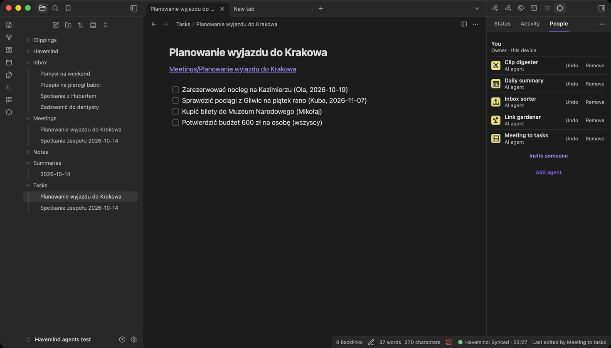

# AI agents in your vault

An agent is a member of your vault that works on its own, in the background.
It is not a chat: it reads its task, waits until people change something, does
the work and goes quiet again. People stay violet in Havemind; agents are
yellow, in the flower, in People and in Activity. Every change an agent makes is
signed with its name and can be undone like anyone's.

You need Havemind 1.10 or newer on the server and in Obsidian, and a way for
the agents to think: your Claude subscription, an API key, or a local Ollama
(see How it thinks). New to Havemind? The [tutorial](tutorial.md) goes from
zero to five working agents, with screenshots.



## Ready-made agents

| Agent | What it does | Writes in |
|---|---|---|
| Inbox sorter | Files new notes from `Inbox/` into folders under `Notes/` | `Inbox`, `Notes` |
| Daily summary | Writes `Summaries/<date>.md`: what changed today, and who did it | `Summaries` |
| Link gardener | Adds links between related notes in a Related section | `Notes` |
| Meeting to tasks | Turns notes in `Meetings/` into task lists with owners and dates | `Tasks` |
| Clip digester | Writes a short digest of each web clip in `Clippings/` | `Clippings/Digests` |

Or pick **Custom** and write the instructions yourself.

## The task note

Each agent has one note, `Havemind/Agents/<Name>.md`, that says what it does:

```markdown
---
may_write: [Inbox, Notes]
every: 1h
---
For each new note in Inbox/, ...
```

- `may_write`: the folders it may create and change notes in, and everything
  below them. Anything else is refused.
- `every`: how often it may run: `30m`, `1h`, `1d`. It runs only when people
  changed something since its last run, so a quiet vault costs nothing.
- The text below: its instructions, in plain words.

Edit it in Obsidian like any note; the agent reads it again before every run.
An agent can never write in `Havemind/` (so it cannot change its own task
note), in `.obsidian/`, in `Havemind Conflicts/` or in the trash, whatever the
note says. It never deletes notes.

## Add an agent

1. In Obsidian, open Havemind, **People**, **Add agent**.
2. Pick a task, change the name if you like, and the first time only choose
   how it thinks (below). Click **Add agent**.

That is all. Havemind writes the task note, the agents service on your server
picks the agent up, and it appears in yellow within a minute. No invitation to
copy, no command, no six digits: you added it from your own signed-in
Havemind, on your own server.

### How it thinks

| Choice | What you give, once | Notes |
|---|---|---|
| **Claude** | the token from `claude setup-token` (Claude Code, your Claude subscription) | the default |
| **Anthropic API** | an API key (`sk-ant-api03-…`) | billed to the key |
| **Other models** | an OpenAI-compatible address, a model and a key | OpenRouter (hundreds of models), OpenAI, Google Gemini, or an Ollama on the server (no key) |

Codex (your ChatGPT subscription) comes later: its sandbox still runs shell
commands next to its login, which is not safe on a server whose agents read
web clips.

The first time an agent thinks with Claude, your server installs Claude Code
for it (the pinned version, into `~/havemind-server/agents/.tools`); the
public Havemind image does not carry it.

**What leaves your server.** Until now nothing in Havemind left your own
server. A running agent sends the text of the notes people changed, and the
list of note paths in the vault, to the model you chose (Anthropic, OpenAI,
OpenRouter, Google...), under that provider's terms. With Ollama on your own
machine nothing leaves it.

It is sent once to your server and kept there in files only the server and
the agents service can read (`~/havemind-server/agent-secrets/`), outside the
database and its backups. Havemind never shows it again. Choosing again
replaces it.

This needs a server set up with the one-command installer from Havemind 1.10
on (it runs the agents service). On a server you run by hand, set
`HAVEMIND_AGENT_SERVICE_TOKEN` and start the `agents` profile, see
`deploy/.env.example`. On an older server, **Invite someone** with the role
**AI agent** still works: it shows a command to run on the server and six
digits to approve.

To see what agents did: the yellow rows in **Activity**, or on the server
`docker compose --project-directory ~/havemind-server logs havemind-agents`.

## Use an agent from Claude Code (MCP)

The same agent can be driven by Claude Code or Claude Desktop instead, through
MCP. It keeps the same name, colour and folders.

1. Download `havemind-agent.mjs` from the latest
   [release](https://github.com/MikolajSapek/havemind/releases/latest) onto
   the computer that runs Claude Code (Node 22 or newer, and Tailscale on that
   computer, signed in to your tailnet).
2. Invite an agent in Havemind as above, then on that computer run
   `node havemind-agent.mjs join`, paste the invitation and approve the six
   digits.
3. Add it to Claude Code:

   ```bash
   claude mcp add havemind-inbox -- node /path/to/havemind-agent.mjs mcp "Inbox sorter"
   ```

Claude Code then has `my_task`, `list_notes`, `read_note` and `write_note`,
the last one held to the agent's folders. One agent runs in one place at a
time: if the background service already runs it, the MCP session says it is
busy. Invite a separate agent for Claude Code.

## Undo and remove

- **People**, the agent, **Undo** (two clicks): every note it
  changed gets back the last version someone else wrote, as a normal edit,
  and notes it created go to the trash. A note a person changed after the
  agent is left alone. An agent that keeps running may do the same work
  again on its next run (the restored notes look like new changes to it), so
  **Remove** it first if you want it gone.
- One note at a time: its history, or **Restore** in **Activity**.
- To stop an agent for good, **People**, the agent, **Remove**. Its tokens stop
  working at once.
- To pause all agents: `docker compose --project-directory ~/havemind-server stop havemind-agents`.

## What it costs

Each run that finds people's changes makes a few model calls (at most 12 turns
and 20 note writes per run). Pick `every` to match how often you want it.
