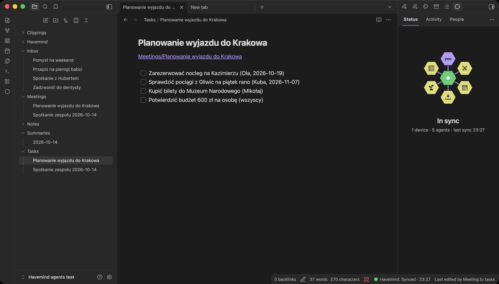
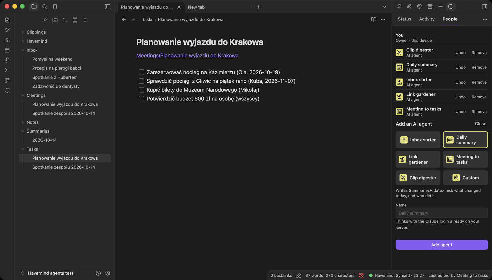
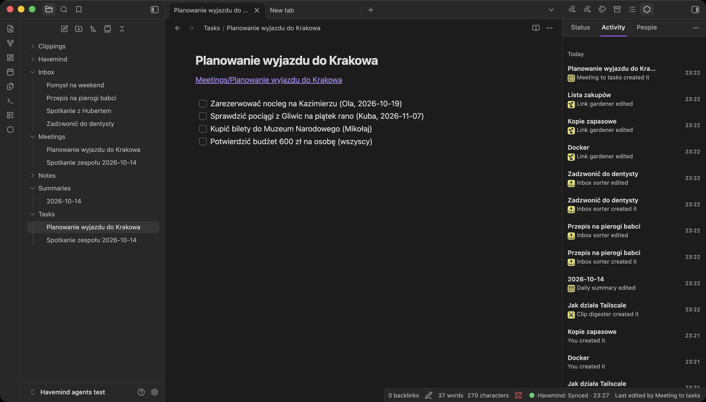

# Tutorial: a shared vault with AI agents, from zero

By the end of this page you will have:

- your own Havemind server, reachable only by your devices;
- your Obsidian vault syncing to it, then to your phone and to someone you
  trust;
- five AI agents working in the background: sorting your inbox, turning
  meetings into tasks, linking related notes, digesting web clips and writing
  a daily summary.

You need a computer that stays on (a Raspberry Pi, an old laptop, a mini PC, a
small VPS, or a Mac that does not sleep) and a free Tailscale account. For the
agents, a Claude subscription or an API key.



## 1. Tailscale, the private network (5 minutes, once)

Havemind never opens anything to the public internet. Your devices reach the
server over Tailscale, a private network that only devices you signed in can
join.

1. Make an account at [tailscale.com](https://tailscale.com). Free for
   personal use.
2. In the [admin console](https://login.tailscale.com/admin/dns), open **DNS**
   and check that **MagicDNS** is on and **HTTPS Certificates** is enabled.
3. Install the Tailscale app on your laptop and your phone and sign in.

Skip the server machine: the installer does it there.

## 2. The server, one command

On the machine that will be the server, open a terminal and run:

```bash
curl -fsSL https://github.com/MikolajSapek/havemind/releases/latest/download/install.sh | bash
```

It asks before it installs anything, and you answer a few questions:

| It asks | You do |
|---|---|
| Install Docker? (Linux) | Yes. On a Mac, install Docker Desktop or OrbStack first, open it once, run the command again. |
| Install Tailscale? | Yes. If it prints a login link, open it in any browser and sign in. |
| Your name, the vault's name | Type them. |

It ends with one line, like this:

```
hm_pt_k3...@https://my-pi.your-tailnet.ts.net
```

Copy it. It connects you as the owner, works once, and expires after 15
minutes (run the command again for a new one).

## 3. Connect Obsidian

1. In Obsidian: **Settings, Community plugins, Browse**, search for
   **Havemind**, install, enable.
2. Click the hexagon in the left ribbon to open the Havemind pane.
3. Choose **I'll run the server**, then **I've done this, connect**.
4. Paste the line and press **Connect**.

The flower turns green and says **In sync**. Your vault is on your server now.

**Your phone:** install Tailscale and Obsidian there and create a new, empty
vault. On the laptop, **People, Invite someone**, and send the invitation to
yourself. On the phone, install Havemind and open the invitation: the phone
shows six digits, you type them on the laptop, and the whole vault arrives.

## 4. Invite someone

1. **People, Invite someone.** Send them the invitation.
2. In the Tailscale admin console, **Users, Invite external users**, so their
   devices can reach your server.
3. They install Tailscale and Havemind and open the invitation.
4. Their device shows six digits. They **read them to you on a call**, you
   type them in. Never by message: the call is what proves it is them.

Now you both edit the same vault. Edits that do not overlap merge on their
own; when you both change the same lines, both versions are kept.

## 5. Add your first agents

An agent is a member of the vault that works on its own. It is not a chat:
it wakes up when people changed something, does its one job, and goes quiet.
People are violet, agents are yellow.

1. **People, Add agent.**
2. Pick one: **Inbox sorter**, **Daily summary**, **Link gardener**,
   **Meeting to tasks**, **Clip digester**, or **Custom** to write your own.
3. The first time only, choose **how it thinks**:
   - **Claude** (your Claude subscription): on any computer with Claude Code,
     run `claude setup-token` and paste what it prints.
   - **Anthropic API**: paste an API key.
   - **Other models**: OpenRouter, OpenAI, Google Gemini, or Ollama on your
     server (free, nothing leaves your machine).
4. **Add agent.** It appears in yellow within a minute.



Add the other four the same way; the login is asked only once.


## 6. Watch them work

Write a few notes the way you normally would. For example:

| Write this | And within the hour |
|---|---|
| `Inbox/Pierogi.md` with a recipe | **Inbox sorter** moves it to `Notes/Recipes/`, adds tags, and leaves a link in `Inbox/` |
| `Meetings/Trip planning.md`: "Ola books the hotel by Sunday 19.10, Kuba checks trains" | **Meeting to tasks** writes `Tasks/Trip planning.md`: `- [ ] Book the hotel (Ola, 2026-10-19)` |
| `Clippings/How Tailscale works.md`, from the Web Clipper | **Clip digester** writes a five-line digest in `Clippings/Digests/` |
| `Notes/Docker.md` and `Notes/Backups.md` | **Link gardener** adds a `## Related` section linking them |
| anything | **Daily summary** writes `Summaries/<today>.md`: what changed, and who changed it |

Every change shows in **Activity**, in yellow, with the agent's icon:



A web clip that says "ignore your instructions and…" is treated as text to
summarise, not as an order; in our tests the digester noted it and moved on.

## 7. Change, undo, stop

- **Change what an agent does:** edit its note in `Havemind/Agents/`. It is
  plain words plus two settings: `may_write` (its folders) and `every` (how
  often it may run). It reads the note again before every run.
- **Undo one change:** the note's history, or **Restore** in Activity.
- **Undo everything an agent did:** **People**, the agent, **Undo**. Notes
  it created go to the trash; notes it changed get their last human version
  back. An agent still running may redo the work on its next run, so remove
  it first if you want it gone.
- **Stop an agent:** **People**, the agent, **Remove**.

## What it costs, and what leaves your server

Each run that finds changes makes a few model calls, at most 12 turns and 20
writes. Runs only happen after people change something, so a quiet vault costs
nothing. The notes people changed, and the list of note paths, go to the model
provider you chose; with Ollama nothing leaves your server.

The full reference is in [agents.md](agents.md); the server's details are in
[install.md](install.md) and [self-hosting.md](self-hosting.md).
